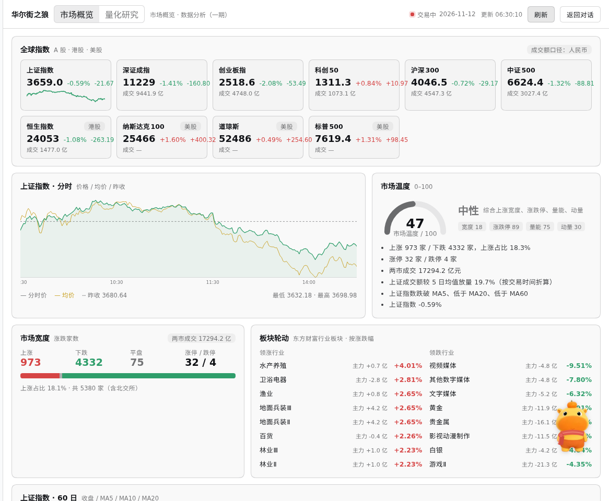

# dsh-wallstreet 「华尔街之狼」

**DSH 里的投资研究面板：A 股/港股/美股盘面、异动盯盘、研究归档与策略口径。**

An investment-research panel for DSH — market overview, intraday moves, research archive and strategy rules for A-shares, Hong Kong and US markets.

[](package.json)
[](LICENSE)
[](https://github.com/frankfurtlin/dsh-pocket)

[中文](README.md) · [English](README.en.md)



## What it is

Wall Street is a DSH plugin that puts a research desk in the sidebar, split into three views: **Market** (indices, SSE intraday, temperature, breadth, sector rotation, 60-day candles), **Moves** (limit-up pool, dragon-tiger list, top movers, industry flows) and **Research** (archived conclusions, valuation percentiles, margin trading, futures and commodities, holdings concentration, sentiment history).

The data normally lives on several sites plus local scripts, and the hard part is not fetching it but knowing what you are looking at. The panel picks its sources by trading session — live feeds during the session, the `market-report` snapshot files after the close — and labels every header and section badge with the data mode, so a T-1 snapshot is never mistaken for an intraday number.

## Features

- **Market** — ten global indices, SSE intraday chart with a change-percent Y axis and crosshair, a 0–100 market temperature, breadth, sector rotation and a 60-day candlestick chart.
- **Moves** — limit-up pool with consecutive-board counts, dragon-tiger list, top/bottom movers, industry net flows; any stock name opens a drill-down with quote, intraday chart and daily candles.
- **Research** — frozen research conclusion plus 34 backtests, valuation percentile / margin / index futures / commodities, holdings concentration, and 40 trading days of sentiment history.
- **Strategy rules** — 8 pure functions (allocation, risk checks, graded stop-loss, annual circuit breaker, grid plan, convertible-bond screen, rotation score, attribution) with two profiles, 100k and 500k CNY.
- **Research search** — Miaoxiang financial search and Tavily web search, covering the gap left by the news feed's few-hour window.
- **Three data layers** — live (60s cache), slow intraday data (close snapshot), and post-close files; each section degrades independently and reports its source.
- **Read-only and gated** — no brokerage account, no orders, no user data stored; every route goes through `ctx.connection.requestRejection()` (401 when signed out, 403 for untrusted Host/Origin).

## Install

```bash
# Plugins page → Add plugin → /root/workspace/plugins/dsh-wallstreet → Install → enable the switch
# or: plugin_manager install_bundle, target=/root/workspace/plugins/dsh-wallstreet
systemctl restart deepseek-harness   # required for the new cordis patch to apply
```

Uninstall is symmetric: `plugin_manager remove_bundle, target=dsh-wallstreet`.

## Configuration

| What | Where | Notes |
| --- | --- | --- |
| Miaoxiang search key | `MX_APIKEY` in `.env.local` | Eastmoney Miaoxiang; used by `/research/search?engine=mx` |
| Tavily key | `TAVILY_API_KEY` in `.env.local` | used by `/research/search?engine=tavily` |
| Env file location | plugin directory, mode `0600` | never commit it; `DSH_WALLSTREET_ENV` can point elsewhere |
| Daily market snapshot | `/root/workspace/market-report/data/market_data.json` | written by the `market-report` pipeline |
| Order-flow archive | `/root/workspace/market-report/data/flow_full.json` | same pipeline |
| Research archive | `data/quant-archive/` | conclusion doc, backtest results, holdings snapshots (~150 KB) |

```bash
printf 'MX_APIKEY=%s\nTAVILY_API_KEY=%s\n' "<mx-key>" "<tavily-key>" > .env.local
chmod 600 .env.local
```

Process environment variables win over the file, which is read once and cached for 60 seconds; keys never leave the host process and are never sent to the browser.

## Usage

Put the panel in the sidebar and switch views from the toolbar. Data is polled every 60 seconds (paused while the tab is hidden) and there is a manual refresh button; a "back to chat" button closes the panel like the host's own close action.

Each header states the mode in use: `盘中实时 · HH:MM 更新` during the session, `收盘快照 · YYYY-MM-DD HH:MM` after it. Both `/overview` and `/moves` return `dataMode` (`live` / `snapshot`) plus `sources`, and the client renders badges from that instead of guessing.

## Data layers

1. **Live (09:15–15:30, 60s TTL)** — indices, intraday and daily candles come from Tencent (`qt.gtimg.cn`, `web.ifzq.gtimg.cn`); advancers/decliners, limit-ups, industry sectors and flows, the limit-up pool and the mover lists come from Eastmoney's realtime endpoints. Turnover is projected to a full-day figure using intraday distribution anchors before any volume ratio is computed.
2. **Slow intraday data** — dragon-tiger list, margin trading, valuation and OMO only exist after the close, so they stay on the latest close snapshot and say so.
3. **After the close (weekends, pre-open)** — everything switches to the files `market-report` writes at 15:10 each trading day, with the snapshot date and fetch time stamped in the UI.

Why the split: Eastmoney's bulk list/sector endpoints are stable intraday but do not agree with the snapshot convention after the close, while Tencent's index/intraday/candle endpoints are stable and low-latency; both are public official APIs, so no paid feed is involved. `beijingNow()` classifies the session as `trading` / `lunch` / `closing` (live) or `preopen` / `closed` / weekend (snapshot). Each live endpoint has a 60-second TTL, request de-duplication, a 3-second negative cache on failure, and a per-section fallback to the snapshot, so one broken upstream degrades one card, not the page.

**Upstream fallbacks.** Since 2026-11-13 Eastmoney's `push2` clist endpoints intermittently reset connections from this host (`UND_ERR_SOCKET`, the same class of reset that once took down the whole host process). The live layer now fails over per section:

- Industry sector changes fetch Eastmoney's four lists through `Promise.allSettled` and fall back to Sina's `newSinaHy.php` (GBK, 49 industries observed) when either side comes back empty.
- The mover list falls back to Sina's `Market_Center.getHQNodeData?node=hs_a&sort=changepercent`.
- Industry net flows have no public substitute and degrade to the snapshot's `sector_flow` (`sources.sectorFlow=snapshot`).
- A successful fallback reports one "switched to Sina" note; only a real failure reports the underlying error.

**Turnover projection.** Intraday turnover is a running total, so comparing it directly with the 5-day average would always look like shrinking volume. `elapsedTradingFraction()` anchors the A-share intraday distribution (09:30–10:00 accounts for 22%, 10:00–11:30 another 19%, the afternoon ramps up), and `projected full day = current total / fraction`. Both the volume component of the temperature score and the "projected full day" on the breadth card use it; after the close the fraction is 1, so the number is exact.

## Market temperature

```
temperature = breadth·0.35 + limit·0.20 + volume·0.20 + momentum·0.25

breadth  = advancers / (advancers + decliners) × 100
limit    = limit-ups / (limit-ups + limit-downs) × 100
volume   = clamp((volume ratio - 0.6) / 0.8 × 100, 0, 100)   # 0.6 → 0, 1.4 → 100
momentum = 50 + clamp(SSE change% × 9, ±30) + MA position (MA20 ±10, MA60 ±5)
```

The volume ratio is today's turnover over the 5-day average, with the intraday projection described above. The result is a heuristic score with five bands and a text signal, not a predictive model.

## Strategy rules

`lib/strategy.js` is pure functions with every parameter collected in `PROFILES`, so changing a rule happens in one place. The original documents are archived in `docs/strategy/` (`PROJECT.md`, `STRATEGY.md`, `STRATEGY_10W.md`).

| Function | Purpose | Rule (100k / 500k profile) |
| --- | --- | --- |
| `allocationTable(id)` | four-bucket allocation, amounts, portfolio target | 100k: cash 10 / core 30 / satellite 45 / enhanced 15 (target 17.5%); 500k: 10 / 50 / 30 / 10 (12.8%) |
| `riskCheck({profileId,positions,totalAssets})` | single stock, single industry, core floor, cash floor | 100k: stock ≤8%, industry ≤20%, core ≥25%, cash ≥5%; 500k: ≤5%, ≤20%, ≥40%, ≥5%; broad-based ETFs excluded from industry concentration |
| `stopLossAction({kind,pnl})` | graded stop-loss: hold / review / cut | 100k: stock −10% / −20%, sector ETF −15% / −25%, convertible bond review at −8%, broad-based never stopped; 500k: stock −15% / −25%, sector ETF −20% |
| `circuitBreaker({ytdReturn})` | annual circuit breaker | −15% pauses active trading for a month, −25% liquidates satellites |
| `gridPlan({low,high,count,capital,last})` | grid order plan and after-fee per-rung return | 10% range, 10 rungs, two-way commission 0.025% |
| `dualLowScreen(bonds)` | convertible-bond double-low screen | conversion premium <20% and pure-bond YTM >2%, sorted ascending by price + premium |
| `rotationScore(rows)` | industry rotation score | 3-month momentum 50% + 6-month 30% + valuation percentile 20% |
| `attribution(modules)` | return attribution | weight × target return, item by item |

Scope: research-rule calculation only. No broker integration, no order placement, no market fetching — data is passed in by the caller. There is no "Strategy" tab in the UI yet; adding one needs a DSH web token to run browser acceptance, so it is left for the next iteration.

## Research search

The Research tab opens with a search card: type one sentence, pick a source, get results that link back to the original pages. It exists because the panel's news feed only covers the last few hours of time flow, not the history of a theme or a stock.

| Engine | Upstream | Good for | Credential |
| --- | --- | --- | --- |
| `mx` (default) | Miaoxiang `mkapi2.dfcfs.com/finskillshub/api/claw/news-search` | financial news, announcements, research notes, policy reading; results carry a source and `authorityLevel` | `MX_APIKEY` |
| `tavily` | Tavily `api.tavily.com/search` | policy text, overseas coverage, company sites, papers | `TAVILY_API_KEY` |

Implementation notes (`lib/search.js`): keys are read once at first request (60-second cache), upstream timeouts are 20s (Tavily 25s), failures collapse into one Chinese error message, the Miaoxiang body field is `query` (not `question` — the API rejects the latter) with the key in the `apikey` header, results come from `data.data.llmSearchResponse.data[]`, and `limit` is clamped to 1–15.

## API

All routes are `GET`, under the `/wallstreet/api` prefix, and require a DSH session.

| Path | Description |
| --- | --- |
| `/overview` | everything the market tab needs in one call (`?trend=0` skips the intraday series) |
| `/overview` returns | `{ok, fetchedAt, trading, dataMode, sources, marketDate, dataTime, indices, trend, breadth, turnover, sectors, summary, analysis, kline, warnings}` |
| `/moves` | limit-up pool (count, detail, consecutive boards), dragon-tiger list, movers, industry flows, plus `dataMode` / `sources` |
| `/stock?code=600519` | drill-down: Tencent quote, intraday and 60 daily candles (A-share, HK, US codes or Tencent prefix) |
| `/news?limit=40` | Sina Finance + Wallstreetcn + Cninfo announcements, each with `time/title/summary/source/url` |
| `/history?days=40` | sentiment history: limit-up/limit-down counts and turnover series from the daily snapshot jsonl |
| `/trend?secid=1.000001` | intraday series for one index |
| `/indices` | index list (secid/code/name/group) |
| `/health` | upstream connectivity self-check |
| `/strategy/profiles` | both profiles: allocation buckets, risk thresholds, grid defaults |
| `/strategy/overview?profile=10w` | allocation table (weight/amount/target), rules and stop-loss examples |
| `/strategy/grid?last=3&count=10&capital=10000` | grid order plan (defaults to ±5% around the last price) |
| `/research/search?q=固态电池&engine=mx\|tavily&limit=10&answer=1` | source search; returns `{engine, query, total, answer?, results[{title,url,source,published,snippet,authority,kind}]}` |

Quantitative research routes: `/quant/overview` (valuation, margin, futures, limit-up pool, dragon-tiger, flows, commodities, OMO, news — amounts in CNY), `/quant/research` (archived conclusion plus the 34 backtests, `counts{effective,edge,invalid,total}` and `strategies`) and `/quant/holdings` (archived concentration snapshot).

News sources: Sina rolling feed (`feed.mix.sina.com.cn/api/roll/get`), Wallstreetcn (`api-one.wallstcn.com/apiv1/content/lives`) and Cninfo announcements (`www.cninfo.com.cn/new/hisAnnouncement/query`, POST). The three are merged newest-first with a 60-second cache, capped at 40 items, each with a source label, time, title and summary, opening the original page in a new tab (`rel="noopener noreferrer"`). A failing source is skipped on its own.

## Repository layout

```
package.json            # bundle metadata (dsh.bundle.patch / dsh.client)
cordis.patch.yml        # inserts id=dsh-wallstreet into the web composition
lib/index.js            # host: /wallstreet prefix routes (market + quant) behind the DSH auth gate
lib/market.js           # host: Tencent live data, snapshot reading, TTL cache, temperature
lib/quant.js            # host: read-only access to market JSON / archived CONCLUSION / holdings
lib/search.js           # host: Miaoxiang + Tavily search
lib/strategy.js         # host: strategy rules as pure functions
data/quant-archive/     # research snapshot taken before the quant workspace was removed
client.js               # client: hand-written ModuleLoader, sidebar row and the three views
docs/strategy/          # archived strategy documents
research/               # raw upstream response samples used for field mapping
verification/           # verify-api / verify-ui / verify-quant-api / verify-quant-ui + shots/
```

## Development

```bash
npm run check              # node --check on all five host/client files
npm run verify:api         # hits real upstreams, asserts data shape and key fields
npm run verify:quant-api   # uses the DSH cookie, asserts /wallstreet/api/quant/*
npm run verify:strategy    # 40+ assertions on the pure functions, routes driven by a fake ctx

node verification/verify-ui.mjs --token='<dsh web token>'        # three tabs + sidebar order
node verification/verify-quant-ui.mjs --token='<dsh web token>'  # research tab
```

The web token can be read from the host log:

```bash
journalctl -u deepseek-harness --no-pager --since today | grep -o 'token=[A-Za-z0-9_-]*' | tail -1
```

**How host changes take effect.** `lib/*.js` runs in the host process. Try the cheap path first: this plugin is a linked package, so appending or changing a comment line in `/root/.dsh/profiles/web/cordis.patch.yml` (`# touch <ISO time>`) triggers a `@deepseek-ai/dsh-hmr` recomposition, and the new host code is live about 5 seconds later — no restart, no interrupted turn (measured 2026-11-19). Only changes to DSH's own cordis services or config need a restart, and a restart kills whatever turn is running; when that is unavoidable, use `/root/workspace/tools/dsh-reload-when-idle.mjs`, which waits for an idle session and must run in its own cgroup:

```bash
systemd-run --unit=dsh-reload-when-idle --collect \
  /root/.nvm/versions/node/v24.21.0/bin/node /root/workspace/tools/dsh-reload-when-idle.mjs --idle-sec=600
node /root/workspace/tools/dsh-reload-when-idle.mjs --once   # just print whether it is idle
```

For intraday verification outside market hours, start a throwaway instance with a fake clock instead of touching the main session:

```bash
NODE_OPTIONS="--require /tmp/fake-date.cjs" dsh web --port 3090 --no-open \
  --trusted-host dsh.frankfurtlin.top >/tmp/dsh3090.log 2>&1 &
DSH_WEB_URL=http://127.0.0.1:3090 node verification/verify-ui.mjs --token=...
```

`verify-ui` grew from 17 to 60 assertions between 2026-11-12 and 2026-11-13 (indices, temperature, breadth, sectors, candles, the three tabs, stock drill-down, news, sentiment history, sticky table headers, and responsive checks at 1440 / 1120 / 768 / 480 px); every recorded run passed against a throwaway instance or the main service, and the screenshots in `verification/shots/` — including `live-fallback/` from a fake-clock intraday run — come from those runs.

## Known limitations

- Live data comes from free public endpoints with a 60-second cache; under extreme conditions they can lag or rate-limit, and a failing section falls back to the snapshot with a badge.
- The limit-up pool's board count follows the short-term-trading convention (consecutive limit-up days); failed limit-up counts are not shown, and the dragon-tiger list only updates after the close.
- Read-only market data: no account, no trading, no user data stored.
- HK/US indices carry only level and change percent — no intraday chart, candles or turnover. HK/US stock drill-downs usually show just the live quote and say so; intraday charts for indices cover the SSE only.
- Breadth, limit-up pool, dragon-tiger and flows come from the daily close snapshot, so intraday they are T-1 data and the header says which date; limit-up detail rows can differ slightly from the headline count (the count includes ST and Beijing Stock Exchange names).
- Market temperature is a heuristic score, not a forecast, and none of it is investment advice.
- If an upstream times out or rate-limits, that section goes empty with a warning at the bottom of the panel; other sections keep working.
- The Research tab is display-only: it triggers no computation and writes nothing. Freshness depends on whether that day's `market-report` cron has run; the page shows the file date and flags stale archives with their age.
- The 34 backtests and the archived conclusion reflect the 2026-11-12 freeze (survivorship bias included; alpha treated as an upper bound). The panel does not re-process them.
- Historical daily reports are not shown here (removed 2026-11-12); the cron still writes them to `kb-data/reports`, and `dsh-kb` indexes them, so read them through the knowledge-base page.

Candidate for the next phase: watchlists with alerts, sector/concept flow rankings, northbound flows, limit-up review (board ladders, failed-limit rate), a temperature history curve (needs `breadth` in the snapshots) and persisting more live data into a local time series.

## License

MIT. See [LICENSE](./LICENSE).

The plugin reads files produced by `market-report` and archives research output from the former `quant` workspace; those files remain the property of their originating projects and are not redistributed here.
