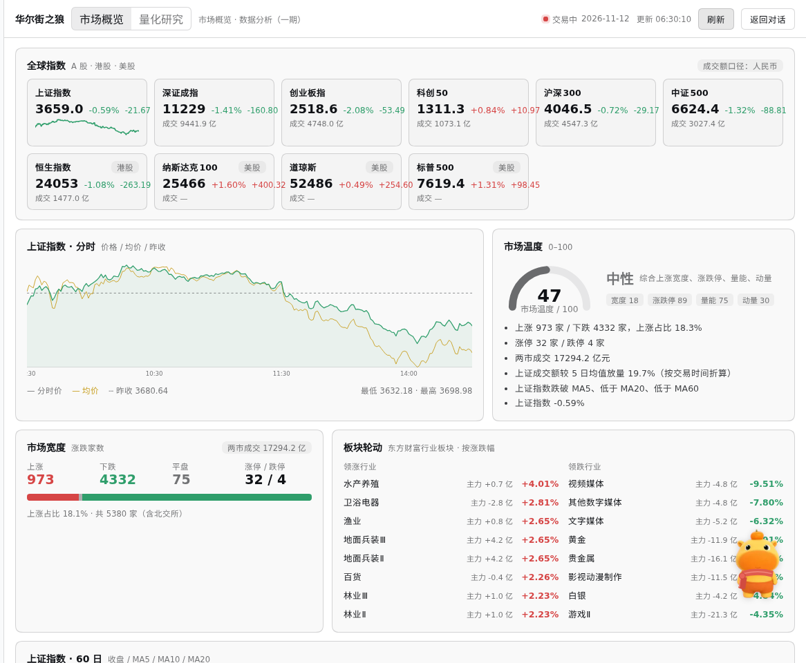

# dsh-wallstreet

Wall Street (华尔街之狼) is a DSH plugin that puts a read-only market desk in the DSH sidebar: indices, intraday charts, limit-up pools, a research archive, and a set of strategy-rule calculators.

**English** · [简体中文](README.zh-CN.md)

[](package.json)
[](LICENSE)



## The problem

Market data is spread over several sites and local scripts, and fetching it was never the hard part. Knowing what you are looking at is: once a live quote and yesterday's close sit on the same screen, they look alike.

The panel picks its source by trading session — live feeds while the market is open, the `market-report` files after the close — and stamps every header and section badge with the mode it actually used, so a T-1 figure is never read as intraday.

## Quick example

```jsonc
// GET /wallstreet/api/overview — live session, trimmed
{
  "dataMode": "live",
  "sources": { "indices": "live", "breadth": "live", "sectors": "live", "trend": "live", "kline": "snapshot" },
  "indices": [{ "code": "000001", "name": "上证指数", "price": 3508.0, "changePct": -0.73 }],
  "breadth": { "up": 3571, "down": 1626, "flat": 182, "total": 5379, "limitUp": 72, "limitDown": 3 }
}
```

Captured during a live session on 2026-11-23 and trimmed here. The interesting part is `kline: "snapshot"`: the 60-day candles come from the last close file even mid-session, and the card says so.

## Install

The commands below assume the checkout is at `/opt/dsh/dsh-wallstreet` — substitute your own path if it lives elsewhere.

```bash
# Plugins page → Add plugin → /opt/dsh/dsh-wallstreet → Install → enable the switch
# or from the plugin manager: install_bundle, target=/opt/dsh/dsh-wallstreet
systemctl restart deepseek-harness   # the new bundle patch applies at startup
```

Uninstall is symmetric: `remove_bundle` with target `dsh-wallstreet`.

## Usage

Open **华尔街之狼** and switch views in the toolbar: **盘面** (market), **异动** (moves), **研究** (research). Data refreshes every 60 seconds while the tab is visible; there is also a manual refresh, and **返回对话** closes the panel.

The header states the mode in use — `盘中实时 · HH:MM 更新` during the session, `收盘快照 · YYYY-MM-DD HH:MM` after it — and sections that stay on the snapshot carry their own badge.

Everything is read-only: no brokerage account, no orders, no user data stored.

## Configuration

| Setting | Default | What it controls |
| --- | --- | --- |
| `MX_APIKEY` | — | Eastmoney Miaoxiang search key, used by `engine=mx` (the default) |
| `TAVILY_API_KEY` | — | Tavily key, used by `engine=tavily` |
| `DSH_WALLSTREET_ENV` | `<plugin>/.env.local` | the file the two keys are read from |
| `DSH_WALLSTREET_MARKET_JSON` | `/opt/dsh/dsh-wallstreet/data/market_data.json` | daily close snapshot behind market, research and history |
| `DSH_WALLSTREET_SNAPSHOT` | `…/market_daily_snapshot.jsonl` | 40-day sentiment history |
| `DSH_WALLSTREET_QUANT_ROOT` | `<plugin>/data/quant-archive` | archived conclusion, 34 backtests, holdings snapshots |

Both search keys are optional: without them the market and research views still work, and only the search card reports that it has no key. Create the file with:

```bash
printf 'MX_APIKEY=%s\nTAVILY_API_KEY=%s\n' "<mx-key>" "<tavily-key>" > .env.local
chmod 600 .env.local
```

Process environment wins over the file, the file is read once and cached for 60 seconds, and the keys never reach the browser. `DSH_WALLSTREET_FLOW_JSON` overrides the order-flow archive the same way (default: `flow_full.json` next to the market file).

## What it doesn't do

- It doesn't trade and it doesn't hold an account. Quotes are read-only and nothing is stored about you.
- It isn't a backtester. The 34 backtests and the conclusion are a frozen 2026-11-12 snapshot; the panel displays them and never re-runs them.
- Hong Kong and US coverage is thin: indices carry level and change percent only, and a HK/US stock drill-down often shows just the live quote.
- It doesn't invent data when an upstream fails. A broken section goes empty with a warning at the bottom, or drops to the snapshot with a badge; the rest of the page keeps working.
- The market temperature is a heuristic score, not a forecast, and none of this is investment advice.
- No watchlists, alerts, northbound flows or limit-up review yet — they are next-phase candidates, listed in the Chinese README.

## Docs

Full design notes are in the Chinese README ([README.zh-CN.md](README.zh-CN.md)): the live/snapshot routing, the Sina fallback added after Eastmoney began resetting connections from this host, the turnover projection, the temperature formula, the strategy profiles, the API table, and the dated acceptance log.

Archived strategy documents are in `docs/strategy/`, and the raw upstream samples used for field mapping are in `research/`.

## Contributing

`npm run check` covers syntax, `npm run verify:api` hits the real upstreams, and `npm run verify:strategy` exercises the pure functions. Code under `lib/` runs in the host process and only takes effect after a restart — don't do that mid-turn; the Chinese README has the reload-when-idle recipe.

## License

MIT — see [LICENSE](LICENSE). The panel reads files written by the `market-report` pipeline and keeps an archive of output from the former `quant` workspace; those files remain the property of their projects and are not redistributed here.
