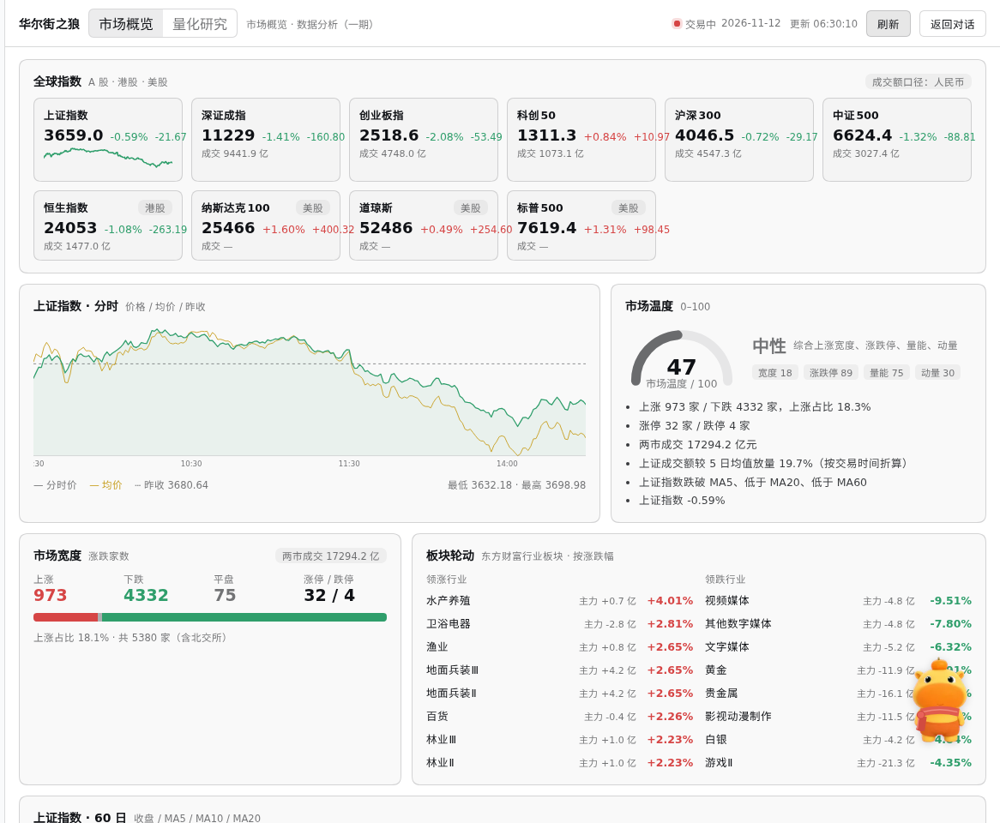

<div align="center">

# dsh-wallstreet 「华尔街之狼」

**DSH 里的投资研究面板：A 股/港股/美股盘面、异动盯盘、研究归档与策略口径。**

[](package.json)
[](LICENSE)

[English](README.md) · **简体中文**

</div>



## 这是什么

华尔街之狼是挂在 DSH Web 侧栏的投资研究面板，三个视图分别对应看盘、盯异动和查研究：盘面看指数、分时、市场温度与宽度；异动看涨停池、龙虎榜、涨跌幅榜与行业资金；研究读归档结论、估值分位、两融、持仓集中度，并带策略口径计算与资料检索。

它解决的问题是这些数据平时散在多个网站和本地脚本里：盘中要实时、盘后要对齐同一份落盘快照，还要能一眼看出「现在是实时还是 T-1」。面板按交易时段自动选路（盘中走实时源、盘后读 market-report 落盘文件），并在页头与分区角标标出数据口径，不让人把快照数据当成盘中数据。

## 功能

- **盘面**：全球 10 个指数、上证分时（含涨跌幅 Y 轴与十字线）、市场温度 0–100、市场宽度、板块轮动、上证 60 日日 K。
- **异动**：涨停池（含连板数）、龙虎榜、全市场涨跌幅前 8/后 8、行业资金净流入/流出，个股可点开弹层看报价、分时与日 K。
- **研究**：归档研究结论与 34 份回测、估值分位 / 两融 / 股指期货 / 商品、持仓集中度、近 40 个交易日市场情绪历史。
- **策略口径**：8 个纯函数（配置表、风控红线、分级止损、年度熔断、网格计划、双低筛选、轮动打分、收益归因），10 万 / 50 万两套画像。
- **资料检索**：妙想金融资讯与 Tavily 全网两个引擎，补上面板原有资讯只有最近几小时时间流的缺口。
- **数据分层**：盘中实时（60 秒缓存）、盘中慢数据（收盘快照）、盘后统一读落盘 JSON 三层，失败按分区降级并标注来源。
- **只读安全**：不接账户、不下单、不存用户数据；所有接口先过 DSH 登录闸门，未登录 401、非受信 Host 403。

## 安装

```bash
# DSH 插件页 → 添加插件 → 填 /root/workspace/plugins/dsh-wallstreet → 安装 → 打开开关
# 或：plugin_manager install_bundle, target=/root/workspace/plugins/dsh-wallstreet
systemctl restart deepseek-harness   # 让新的 cordis patch 生效
```

投资研究面板。挂在 DSH Web 侧栏，排在「紫微斗数」之后，工具栏分三个视图：

- **盘面**：A 股/港股/美股指数、上证分时、市场温度、市场宽度、板块轮动、上证 60 日趋势；
- **异动**：涨停池、龙虎榜、涨跌幅榜、板块资金流、行业资金流向榜；
- **研究**：归档的研究结论与 34 份回测、估值分位/两融/期货商品、持仓集中度（只读归档）。

数据分三层，按「现在是盘中还是盘后」自动选路：

1. **盘中实时**（9:15–15:30，60 秒缓存）：指数/分时/日 K 走腾讯 `qt.gtimg.cn`、`web.ifzq.gtimg.cn`；
   涨跌家数、涨跌停、行业板块与行业资金、涨停池明细、涨跌幅榜走东方财富实时接口
   （行业板块与涨跌幅榜另有新浪财经兜底，见下）；成交额按日内成交分布锚点折算成
   「全天预计量」后再算量能比。
2. **盘中慢数据**：龙虎榜、两融、估值、OMO 等收盘后才产生的数据仍取最新收盘快照，
   页头与分区角标会标出「收盘快照」。
3. **盘后（含周末/盘前）**：全部改用 market-report 每日 15:10 落盘的
   `/root/market_data.json`（`/root/workspace/market-report/` 管线）与 `/root/flow_full.json`，
   并标注快照日期与抓取时间。

首页头部右上角统一显示当前口径：盘中是「盘中实时 · HH:MM 更新」，盘后是
「收盘快照 · YYYY-MM-DD HH:MM」；`/overview` 与 `/moves` 均返回 `dataMode`（live/snapshot）
与 `sources`（每个分区的来源），前端据此加角标，不在前端猜测。

> 为什么东财只用于盘中：东财 push2 的「全量列表/板块」接口盘中稳定，但盘后与快照口径
> 不一致；腾讯的指数/分时/K 线稳定且延迟低。两者都用官方公开接口，不引入付费源。
> 早期 push2his 曾对本站间歇 RST（`UND_ERR_SOCKET`），现在实时层只保留轻量接口 + 单独
> 降级，失败不会拖垮整页。
>
> 2026-11-13 12:59 起本机到东财 `push2.eastmoney.com`（`/api/qt/clist/get`）被持续 RST
> （`curl` 直接 `http=000`、Node `UND_ERR_SOCKET`，对端 14.103.191.91），与当年导致宿主
> 进程崩溃的是同一类上游重置。为此「行业板块涨跌幅」和「个股涨跌幅榜」各加了一条新浪
> 兜底，东财不可达时盘中仍出实时数据；行业资金流没有公开替代源，自动降级为收盘快照。
> 兜底成功时只留一条「已切换新浪源」提示，不保留原始 `fetch failed` 噪音。

## 功能

### 盘面（实时 + 快照）

| 分区 | 内容 | 数据源 |
| --- | --- | --- |
| 一句话结论 | 顶部横幅：量能（放量/缩量/平量）× 涨跌（上涨/下跌/震荡）+ 上证涨跌幅、上涨占比、涨跌停、温度 | 快照 + 实时合成 |
| 全球指数 | 上证、深证、创业板、科创50、沪深300、中证500、恒生、纳指100、道指、标普500；宽屏固定 5×2、卡高一致 | 腾讯 `qt.gtimg.cn` |
| 上证分时 | 价格线 + 均价线（逐分钟成交量加权）+ 昨收基准 + 左侧涨跌幅 Y 轴 + hover 十字线（时间/价格/涨跌幅/均价浮层） | 腾讯 minute |
| 市场温度 | 0–100 分（宽度 35% + 涨跌停 20% + 量能 20% + 动量 25%），五档标签 + 文字信号 | 快照 + 实时合成 |
| 市场宽度 | 涨/跌/平家数、涨停/跌停家数、堆叠条、两市成交额、预计全天成交额、近 5 日累计涨跌家数 | 盘中：东财 fenbu+涨跌停池；盘后：`market_data.json` breadth |
| 板块轮动 | 领涨/领跌行业（盘中为东财实时行业板块，主力净流入随行展示） | 盘中：东财 clist，被 RST 时自动切新浪 `newSinaHy.php`；盘后：`market_data.json` sectors |
| 60 日日K | 蜡烛图（开/高/低/收）+ MA5/MA10/MA20 + 成交量柱、5 日均量对比 | 腾讯 fqkline |

页头与每个分区右上角都标注数据口径：腾讯部分为「实时」，快照/归档部分为「收盘快照」，
两者混排时显示「实时 · 快照 HH:MM」，避免把 T-1 数据误当成盘中数据。

### 异动（盘中实时 / 盘后快照）

| 分区 | 内容 | 数据源 |
| --- | --- | --- |
| 涨停池 | 今日/昨日家数、个股、代码、涨幅、首封时间、**连板数**、行业 | 盘中：东财涨停池；盘后：`market_data.json` zt_pool |
| 龙虎榜 | 按净买入额排序前 10（含上榜原因） | `market_data.json` lhb |
| 涨跌幅榜 | 全市场涨幅前 8 / 跌幅前 8 | 盘中：东财 clist，被 RST 时自动切新浪 `getHQNodeData`；盘后：`market_data.json` top10/bot10 |
| 行业资金流 | 行业净流入/净流出前 6（净额、领涨股、领涨幅）；原「板块资金流 / 资金流向榜」两块重复数据已合并为一块；盘中无领涨股字段时自动省略该列 | 盘中：东财 clist 主力净额（无公开替代源，不可达时降级快照）；盘后：`market_data.json` sector_flow |
| 个股下钻 | 涨停池 / 龙虎榜 / 涨跌幅榜的个股名称可点击，弹层查看实时报价 + 分时 + 近 60 日日 K；弹层内可输入代码切换（600519 / 00700 / AAPL），Esc 关闭并锁背景滚动 | 腾讯 `qt.gtimg.cn` / minute / fqkline |

页面每 60s 轮询一次（标签页隐藏时暂停），也可手动「刷新」；工具栏有「返回对话」按钮，
等价于宿主的关闭面板。

## 盘中实时与消息源（2026-11-13）

### 实时判定

`beijingNow()` 判定交易时段：`trading` / `lunch` / `closing` 视为盘中，走实时层；
`preopen` / `closed` / 周末走收盘快照。实时层每个接口 60 秒 TTL、并发去重、失败
3 秒负缓存并自动回退到快照，单个分区失败只影响该分区（页面显示「暂不可用」并继续可用）。

### 上游兜底（2026-11-13 起）

东财 `push2` 的 clist 系列对本站间歇性 RST 后，盘中实时层按分区独立兜底：

- 行业板块涨跌幅：东财四路（涨幅/跌幅/资金流入/流出）改为 `Promise.allSettled`，涨幅榜
  或跌幅榜为空时改抓新浪 `https://vip.stock.finance.sina.com.cn/q/view/newSinaHy.php`
  （GBK，`var S_Finance_bankuai_sinaindustry`，字段 `名称,家数,均价,…,涨跌幅`，实测 49 个行业）；
- 个股涨跌幅榜：东财前 8/后 8 为空时改抓新浪
  `…/quotes_service/api/json_v2.php/Market_Center.getHQNodeData?node=hs_a&sort=changepercent`；
- 行业资金流：无公开替代源，直接降级为收盘快照的 `sector_flow`（`sources.sectorFlow=snapshot`）；
- 兜底成功只报一条「已切换新浪源」，失败才报具体错误，避免面板被上游噪音刷屏。

### 成交额折算

盘中「两市成交」只是到当前时刻的累计值，直接和 5 日均值比会永远显示缩量。
`elapsedTradingFraction()` 按 A 股日内成交分布锚点（09:30–10:00 占 22%、10:00–11:30 再
19%、午后逐步放量）折算已走完的交易分钟占比，`预计全天 = 当前累计 / 占比`；温度里的量能
比与宽度卡上的「预计全天」都用该值，收盘后占比为 1、即精确值。

### 消息源（研究 tab「财经快讯与公告」）

| 来源 | 接口 | 内容 |
| --- | --- | --- |
| 新浪财经滚动 | `feed.mix.sina.com.cn/api/roll/get` | 财经/市场快讯、媒体名、原文链接 |
| 华尔街见闻 | `api-one.wallstcn.com/apiv1/content/lives` | 全球快讯，原文链接 |
| 巨潮公告（深/沪） | `www.cninfo.com.cn/new/hisAnnouncement/query`（POST） | 上市公司公告，PDF 原文链接 |

三源合并后按时间倒序、60 秒缓存，最多 40 条；每条带来源标签、时间、标题、摘要，
点击在新标签页打开原文（`target=_blank rel="noopener noreferrer"`）。单个源失败只降级该源。

## 市场温度怎么算

```
温度 = 宽度分·0.35 + 涨跌停分·0.20 + 量能分·0.20 + 动量分·0.25

宽度分 = 上涨家数 / (上涨 + 下跌) × 100
涨跌停分 = 涨停数 / (涨停 + 跌停) × 100
量能分 = clamp((量能比 - 0.6) / 0.8 × 100, 0, 100)   # 量能比 0.6→0，1.4→100
动量分 = 50 + clamp(上证涨跌幅 × 9, ±30) + 均线站位（MA20 ±10，MA60 ±5）
```

量能比 = 今日成交额 / 5 日平均成交额。盘中今日成交额只是「到目前」的量，因此按
A 股日内成交分布锚点（开盘半小时最密、午盘清淡、尾盘放量）折算成「全天预计量」
再比较，避免盘中永远显示缩量；收盘后即为精确值。信号文案会标注「按交易时间折算」。

## 研究（只读归档）

`/root/workspace/quant` 已于 2026-11-12 整体删除。为保住每日数据与既有研究产出，做了两件事：

1. **每日采集/日报管线迁出**为独立项目 `/root/workspace/market-report`（cron 任务不变：
   每交易日 15:10 由 Hermes 执行 `~/.hermes/scripts/run_market_report.sh`，产出
   `/root/market_data.json`、`/root/flow_full.json` 与 betterlife 日报）。
2. **研究快照随插件归档**在 `data/quant-archive/`（结论文档、34 份回测结果、持仓集中度
   快照，共约 150KB）——研究结论是 2026-11-12 的冻结口径，不再随时间更新。

面板只读这些文件，不启动 Python、不触发计算：

| 分区 | 来源 | 内容 |
| --- | --- | --- |
| 研究结论 | `data/quant-archive/docs/CONCLUSION.md` + `data/quant-archive/backtests/results/*.json` | 一句话结论、两条前提、有效/边缘/无效计数、34 份回测按 `act_t` 降序（归档快照） |
| 估值分位 / 两融 / 期货商品 | `/root/market_data.json`（交易日 15:11 更新） | PE(TTM) 历史分位、沪深两融、股指期货、BC 指数与沪金/沪银/沪铜/沪铝 |
| 持仓集中度 | `data/quant-archive/data/holdings_concentration_<date>.json` | 分组权重、HHI、风险簇权重与 alerts；快照过期会显示年龄提示（归档快照） |
| 新闻/公告 | `/root/market_data.json` | 央行 OMO、财联社电报、公告与快讯 |
| 市场情绪历史 | `market-report/data/market_daily_snapshot.jsonl`（近 40 个交易日） | 涨停/跌停家数双折线 + 两市成交额走势；纵轴按 90 分位缩放，峰值单独标注 |

市场数据文件由 market-report 管线每日更新，因此面板不轮询，只提供「刷新」按钮；管线
当天没跑或文件缺失时，对应分区降级显示提示，不影响盘面与异动。

quant 接口（同前缀 `/wallstreet/api`）：

| 路径 | 说明 |
| --- | --- |
| `/quant/overview` | 估值、两融、期货、涨停池、龙虎榜、资金流、商品、OMO、新闻（金额统一为「元」） |
| `/quant/research` | 归档研究结论 + 34 份回测聚合（`counts{effective,edge,invalid,total}`、`strategies`） |
| `/quant/holdings` | 归档持仓集中度快照（`snapshot{...}`） |

**历史日报模块已于 2026-11-12 按需求移除**：Hermes cron 生成的日报继续落在
`betterlife/reports/`，由 dsh-kb 自动扫描收录（`KB_REPORTS_DIR` 指向同一目录，60s 索引
缓存），量化研究视图不再重复展示，也不存在日报转发/静态资源代理。

## 功能补充（bug 修复记录，2026-11-12）

- 上游 `fetch` 失败曾被缓存成一个永远没人 await 的 `Promise.reject`，Node 默认把未处理
  拒绝当作致命错误 —— 东财抖动会连带打死整个 DSH 宿主。现已改为负缓存 + 连接类重试
  （400ms/900ms 退避），异常收敛为普通 `Error`；`apply()` 外层加同步兜底，行情故障只
  影响本面板。

## 响应式布局（2026-11-12）

面板按**容器宽度**（不只是视口）自适应，窄到手机宽度也能用：

| 断点 | 行为 |
| --- | --- |
| 面板 ≥ 860px | 盘面「分时 + 温度」两栏；宽度 / 板块两栏 |
| 面板 < 860px | 分时与温度、宽度与板块改为单栏；温度卡圆环与文字自动换行 |
| 面板 < 580px | 全球指数自动降为 2 列、宽度统计 2×2、板块领涨/领跌上下排列、页头副标题隐藏 |
| 视口 < 960px | DSH 外壳收起侧栏、左上角出现浮动按钮；面板工具栏自动让出 52px，标题不再被遮挡 |

- 实现：`ResizeObserver` 观察面板根节点取容器宽度（`useElementWidth`）；视口级用
  `matchMedia`（`useMediaQuery`）判断外壳紧凑态。卡片网格统一
  `repeat(auto-fit, minmax(...))`，价格行 / 温度行 / 页头等文本行允许 `flex-wrap`。
- 表格（涨停池 / 龙虎榜 / 涨跌幅榜 / 板块资金流 / 资金流向榜）在窄屏保留完整列，
  卡片内部横向滚动，不撑破整体布局。
- 分时图第一个 / 最后一个时间刻度改为左右对齐，避免 `09:30`、`15:00` 被 SVG 边界裁掉。
- 回归：`verify-ui` 在 768px 与 480px 两个宽度下逐 tab 断言 `scrollWidth <= clientWidth`
  （面板与页面均不得出现横向滚动），共 6 条断言；截图
  `verification/shots/responsive-*.png`。

## 视觉与体验优化（2026-11-12 20:15，按 ①②③④ 顺序）

1. **指数卡 5×2 与数字排版**：宽屏固定 5 列 × 2 行（10 个指数不再出现 6+4 残行），
   窄屏自动 2 列；卡片底部统一展示成交额（28px 高，同一行卡高一致；原先只有上证卡带
   迷你走势、其余是文字，视觉不齐，2026-11-12 20:45 已统一）；价格、涨跌幅、大数字
   统一 `ui-monospace` 等宽字体；涨跌点降为灰色小字，避免和涨跌幅三重同色强调。
2. **P0 三项**：盘面顶部「一句话盘面结论」（量能 × 涨跌 + 关键指标）；页头与分区角标区分
   实时/快照；宽度卡补「近 5 日累计：上涨 X 家 / 下跌 Y 家」。
3. **个股下钻**：涨停池、龙虎榜、涨跌幅榜的个股名可点开弹层，实时报价 + 分时 + 近 60 日
   K 线；港股/美股个股若上游无分时/日 K，弹层降级为「仅显示实时报价」，A 股走全量。
4. **市场情绪历史**：研究 tab 新增近 40 个交易日的涨停/跌停家数双折线与两市成交额走势，
   读 market-report 的 `market_daily_snapshot.jsonl`，不额外请求行情。

配套修复：temperature 信号里的「上涨占比」统一用含平盘总家数（与宽度卡/结论一致，
不再出现 15.9% / 15.7% 两种口径）；`loadStockQuote` 正则改为 `/v_(\w+)=/` 以匹配大写
美股代码；`resolveTencentCode` 不再把 `usAAPL` 小写成 `usaapl`。

表格表头固定（2026-11-12 20:45）：异动/研究页内所有 `MiniTable` 滚动时表头吸顶；
`th` 从 `background: inherit`（透明，行内容会从表头后面透出来）改为实色
`color-mix(in srgb, currentColor 2.5%, #fff)` + `z-index: 2` + 底部内阴影分隔线。

## 图表与交互增强（2026-11-13）

1. **分时图可读性**：左侧新增以昨收为 0 的涨跌幅 Y 轴（±0.25%/0.5%/1%/2%/3%/5% 自适应
   取整，0% 为虚线），鼠标移入显示十字虚线 + 浮层（时间、价格、涨跌幅、均价）；
   纵轴按对称区间留白，均价线与「最低/最高」图例保持实际值。
2. **60 日真 K 线**：由收盘折线改为蜡烛图（红涨绿跌、实体 + 上下影线）+ 三条均线 +
   底部成交量柱；Y 轴给出三档价格刻度，右上角标注最新收盘与日期。
3. **个股弹层可用性**：弹层内新增搜索框（回车切换代码，支持 A 股/港股/美股），
   `Esc` 关闭弹层，打开期间锁 `body` 滚动避免背后页面跟着滚。
4. **异动页去重**：把「板块资金流」（sector_flow）与「资金流向榜」（flow_full.json）
   两块高度重复的行业资金数据合并为「行业资金流」一块，净额前 6 / 后 6 各带领涨股与
   领涨幅，页面少一块重复内容。

## API（全部 GET，仅 DSH 登录后可访问）

行情接口（一期）：

前缀 `/wallstreet/api`：

| 路径 | 说明 |
| --- | --- |
| `/overview` | 一次性返回面板所需的全部数据（`?trend=0` 可跳过分时） |
| `/overview` 返回 | `{ok, fetchedAt, trading, dataMode, sources, marketDate, dataTime, indices, trend, breadth, turnover, sectors, summary, analysis, kline, warnings}` |
| `/moves` | 异动页数据：涨停池（家数+明细+连板）、龙虎榜、涨跌幅榜、行业资金流；返回 `dataMode`/`sources` |
| `/stock?code=600519` | 个股下钻：腾讯实时报价 + 分时 + 近 60 日日 K（支持 A 股/港股/美股代码或腾讯前缀） |
| `/news?limit=40` | 财经快讯与公告：新浪财经 + 华尔街见闻 + 巨潮公告，每条含 `time/title/summary/source/url` |
| `/history?days=40` | 市场情绪历史：涨停/跌停家数与两市成交额时间序列（读 market-report 每日快照 jsonl） |
| `/trend?secid=1.000001` | 单个指数的分时 |
| `/indices` | 指数清单（secid/code/name/group） |
| `/health` | 上游连通性自检 |

量化研究接口（二期）见上一节。

鉴权：所有请求先过 `ctx.connection.requestRejection(req)`——Host/Origin 不在信任
列表返回 403，未登录返回 401；不存在绕过登录的路径。

## 安装 / 卸载

只由 Lead 在 DSH 里操作：

```bash
# 安装（包目录即 link: 依赖，不发布 npm）
# plugin_manager: action=install_bundle, target=/root/workspace/plugins/dsh-wallstreet
# 之后重启 deepseek-harness 让新的 bundle patch 生效

# 卸载
# plugin_manager: action=remove_bundle, target=dsh-wallstreet
```

## 本地验证

```bash
cd /root/workspace/plugins/dsh-wallstreet
npm run check              # node --check 三个文件
npm run verify:api         # 打真实上游，断言数据形状与关键字段
npm run verify:quant-api   # 走 DSH cookie，断言 /wallstreet/api/quant/*

# DSH 内浏览器验收（Playwright headless，token 从 dsh web 启动日志取）
node verification/verify-ui.mjs --token='<dsh web token>'        # 盘面/异动/研究 三 tab + 侧栏顺序
node verification/verify-quant-ui.mjs --token='<dsh web token>'  # 研究 tab（归档结论/估值/持仓）
# 截图输出到 verification/shots/
```

token 可从宿主日志取：

```bash
journalctl -u deepseek-harness --no-pager --since today | grep -o 'token=[A-Za-z0-9_-]*' | tail -1
```

### 后端改动如何生效（要重启宿主，注意时机）

`lib/*.js` 是宿主端代码，改完必须重启 `deepseek-harness` 才生效；在回合内直接重启会打断
正在跑的回合。用 `/root/workspace/tools/dsh-reload-when-idle.mjs`：按会话事件判定空闲
（最后一条事件是 `turn/end` 之类才算空闲，长工具调用期间不会被误判），空闲 10 分钟后重启，
脚本必须跑在独立 cgroup（`systemd-run`）里，否则会跟着服务一起被杀：

```bash
systemd-run --unit=dsh-reload-when-idle --collect \
  /root/.nvm/versions/node/v24.21.0/bin/node /root/workspace/tools/dsh-reload-when-idle.mjs --idle-sec=600
cat /tmp/dsh-reload-when-idle.log                              # 判定过程与重启结果
node /root/workspace/tools/dsh-reload-when-idle.mjs --once     # 只看当前是否空闲
```

盘中复验可以用假时钟另起临时实例，不打断主会话：

```bash
NODE_OPTIONS="--require /tmp/fake-date.cjs" dsh web --port 3090 --no-open \
  --trusted-host dsh.frankfurtlin.top >/tmp/dsh3090.log 2>&1 &
DSH_WEB_URL=http://127.0.0.1:3090 node verification/verify-ui.mjs --token=...
```

### 验收结果（2026-11-12 11:15，盘中）

- `verify:api`：28 项全 PASS（10/10 指数、分时 100 点、宽度 5380 家、涨停池 44 家、成交额约 1.12 万亿、温度 70「偏暖」、量能比 1.48）。
- `verify-ui`：17 项全 PASS。侧栏顺序实测 `tavern → kb → ziwei → wallstreet`，自动化任务在酒馆之前；面板 10 张指数卡、温度/宽度/板块/60 日均线图全部渲染，刷新命中 `/wallstreet/api/overview` 200，返回对话正常，无 JS 异常、无失败接口请求。
- 截图：`verification/shots/sidebar.png`（侧栏顺序）、`wallstreet-panel.png`（面板首屏）、`wallstreet-bottom.png`（60 日 K 线）。

### 验收结果（2026-11-12 14:30，quant 合并后）

在临时实例（`--port 3090`，同一 profile）上用最终代码验收，避免打断主会话：

- `verify:quant-api`：21 项全 PASS（overview 估值/两融/涨停池/龙虎榜、研究结论 34 份
  计数一致、日报 40 期、持仓快照 HHI 0.4545、日报 HTML 资源改写且无 `share.js`、
  静态资源 200、非法日期与路径穿越 404）。
- `verify-quant-ui`：19 项全 PASS（切 tab、研究结论/34 行策略表、估值分位/涨停池/
  龙虎榜/资金流、40 期日报、打开 20261111 日报 iframe 200、关闭、刷新命中
  `/quant/overview`、切回概览 10 张指数卡、无失败请求、无 JS 异常）。
- `verify-ui` 回归：17 项全 PASS（市场概览未被量化视图破坏）。
- 截图：`verification/shots/quant-research.png`、`quant-report-modal.png`。
- 备注：本轮验证后需重启主服务（3080）一次，加载最终代码。

### 验收结果（2026-11-12 15:05，移除历史日报模块后）

按需求移除「量化研究 · 历史日报」模块（Hermes cron 日报改由 dsh-kb 自动收录），
在临时实例（`--port 3090`）复验：

- `verify:quant-api`：16 项全 PASS（overview/研究结论/持仓集中度；旧 `/quant/reports`、
  `/quant/report/<date>`、`/quant/assets/<name>` 三条接口均确认 404 下线）。
- `verify-quant-ui`：15 项全 PASS（切 tab、研究结论/101 行表格、估值/涨停池/龙虎榜/
  资金流、持仓集中度、页头数据日期、刷新命中 `/quant/overview`、切回概览 10 张指数卡、
  无失败请求、无 JS 异常）。
- `verify-ui` 回归：侧栏顺序与面板入口 4 项 PASS；概览渲染两项受东财接口临时限流影响
  未能在本轮跑通（同一时刻 `curl push2.eastmoney.com` 返回空响应，属上游环境问题，
  12 分钟内多次运行可能触发限流；代码未改动概览路径）。

### 验收结果（2026-11-12 15:15，quant 删除 + 管线迁移后）

`/root/workspace/quant` 已删除，采集/渲染管线迁到 `/root/workspace/market-report`：
迁移后的完整 cron 流程实跑一次，**QC 16/16 PASS**，15:14:41 生成并部署
`reports/20261112/a-share-market-overview-20261112.html`；dsh-kb 已自动收录
（标题「A股市场全景分析报告 | 2026-11-12 收盘」）。研究快照归档在 `data/quant-archive/`。

浏览器/接口验收（临时实例 3090，final 代码）：

- `verify-quant-api`：15/16 PASS——overview/research/holdings 全部正常（回测 34 份、
  HHI 0.4545、快照 35 天），旧日报接口 404 确认下线；唯一失败项是 `/health` 的
  `ok` 标志为 false：当时东财 `push2` 接口被上游限流（`curl` 直接 `http=000`），
  故障按设计收敛为 degraded（HTTP 仍 200），不是代码回归。
- `verify-quant-ui`：13 项 PASS（切 tab、研究结论/34 行策略表、估值/涨停池/龙虎榜/资金流、
  持仓集中度、页头日期、「历史日报模块已移除」、刷新命中 `/quant/overview`）；
  最后切回概览等待指数卡超时，原因同上（行情不可用）。
- `verify-ui`：侧栏顺序/入口 4 项 PASS（tavern → kb → ziwei → wallstreet，自动化任务在前）；
  概览渲染同样受上游行情不可用阻塞。
- 结论：与本次删除/迁移相关的接线全部验证通过；行情渲染待东财恢复后复验即可
  （概览代码路径本次未改动）。

备份：删除前把配置/脚本/文档/回测结果/数据快照打包为
`/root/workspace/archive/quant-2026-11-12.tar.gz`（1.5MB，回测缓存与站点产物已排除）。

### 验收结果（2026-11-12 16:10，三 tab 重构后，临时实例 3090）

为避免打断主会话，在临时实例（`--port 3090`，同一 profile）上用最终代码验收：

- `verify-api`：全部 PASS（含新增 `/moves` 8 项断言：涨停池家数/明细/首封时间格式、
  龙虎榜 ≥5 行、涨跌幅榜、板块资金流、资金流向榜）。
- `verify-ui`：32 项全 PASS —— 盘面 10 张指数卡（含港股/美股）、温度 44「中性」、
  宽度/板块/60 日 K；异动 5 个区块（涨停池/龙虎榜/涨跌幅榜/板块资金流/资金流向榜，
  且不含指数卡）；研究 结论/策略统计/估值分位/持仓集中度（且不含异动区块）；
  三个 tab 刷新分别命中 `/overview`、`/moves`、`/quant/overview` 200；
  无 JS 异常、无失败接口请求。截图：`verification/shots/{wallstreet-market,
  wallstreet-moves,wallstreet-research}.png`。
- `verify-quant-api`：16 项全 PASS；`verify-quant-ui`：15 项全 PASS。
- 备注：主服务 3080 需重启一次加载新的 host 代码（腾讯数据层 + `/moves` 路由）。

### 验收结果（2026-11-12 17:27，指数卡片溢出修复后，主服务 3080）

- 现象：面板宽度被侧栏压缩时（视口 ≤1120），全球指数卡片的「价格 + 涨跌幅 + 涨跌点」
  单行放不下（186px 卡内溢出 5–17px，NDX/道指/标普最明显），内容被裁切。
- 修复：价格行改为 `flex-wrap`（放不下时涨跌点换行），卡片列宽从 150px 提到 168px，
  卡片加 `overflow: hidden`，价格字号 18→17；涨跌点单独占行时可读、不再横向溢出。
- `verify-ui` 新增两条回归断言（1440 与 1120 两档逐卡检查 `scrollWidth <= clientWidth`
  且子元素无溢出），全套 34 项全 PASS；截图 `verification/shots/wallstreet-market.png`。

### 验收结果（2026-11-12 19:35，响应式适配后，主服务 3080）

- `verify-ui` 40 项全 PASS，其中新增 6 条响应式断言：768px、480px 两个宽度 ×
  盘面/异动/研究 三个 tab，面板与页面 `scrollWidth - clientWidth` 均为 0。
- 逐档实测（1440 / 1024 / 820 / 768 / 600 / 480）：三 tab 无任何可见元素越界，
  无文本被裁切；页头在窄屏自动让出外壳浮动按钮的位置，温度标签不再竖排。
- 截图：`verification/shots/responsive-{480,768}-*.png`。

### 验收结果（2026-11-12 20:15，四项优化后，临时实例 3090）

- `verify-api`：全部 PASS（新增 summary / `/stock` A 股·港股·美股 / 非法代码拒绝 /
  `/history` 共 12 项断言；A 股茅台 1410.27、分时 267 点、日 K 60 根；情绪历史 40 天，
  末点 `2026-11-12 zt=36 dt=24 amount=1.9456e12`）。
- `verify-ui`：**47 项全 PASS**（新增一句话结论、时效标签、近 5 日、个股名称可点击、
  弹层打开/含分时·日K/可关闭、研究·市场情绪历史共 9 项）。
- `verify-quant-ui`：**14 项全 PASS**（研究视图新增情绪历史后仍无重复区块）。
- 截图：`verification/shots/wallstreet-market.png`、`wallstreet-moves.png`、
  `wallstreet-stock-modal.png`、`wallstreet-research.png`。
- 备注：client.js 改动刷新即生效；`lib/market.js` 与 `lib/index.js` 新增 `/stock`、`/history`
  与 `summary`，需重启一次 deepseek-harness 才能在主服务 3080 生效（重启后 web token 轮换）。

### 验收结果（2026-11-13 08:45，图表与交互增强，主服务 3080）

- `verify-ui`：**54 项全 PASS**（新增「分时图含涨跌幅 Y 轴刻度」「hover 显示十字线浮层」
  「60 日K线为蜡烛图（120 个 rect）」「行业资金流含领涨股」「资金流向榜已合并」
  「个股弹层含搜索框」「搜索 600519 切换到贵州茅台」「Esc 关闭弹层」共 8 条）；
  盘面 10 张指数卡、一句话结论、近 5 日、异动表头吸顶、三 tab 刷新、响应式 768/480 均保持通过。
- `verify-quant-ui`：全部 PASS；`npm run check`（三个文件语法）通过。
- 截图：`verification/shots/wallstreet-market.png`、`wallstreet-moves.png`、
  `wallstreet-stock-modal.png`、`wallstreet-research.png`。
- 备注：本轮只改 `client.js`，刷新即生效、无需重启宿主；后端 `/stock`、`/history`、
  `summary` 已在 2026-11-12 20:23 随服务重启上线。

### 验收结果（2026-11-12 20:48，指数卡一致性与表头固定）

- `verify-ui`：**49 项全 PASS**（新增「指数卡底部统一展示成交额，10 张卡均无迷你走势」
  与「异动表格滚动 160px 后表头 top=0 且背景不透明」两条断言）。
- 截图：`verification/shots/wallstreet-market.png`、`wallstreet-moves.png`、
  `wallstreet-research.png`（表头吸顶，滚动时行内容不再透出）。

### 验收结果（2026-11-13 11:00，盘中实时 + 消息源，临时实例 3090）

- `verify-api`：全部通过（含 `dataMode/sources`、盘中涨跌家数/行业板块实时来源、涨停池连板数、`/news` 三源合并与原文链接）。
- `verify-ui`：**60 项全 PASS**（页头「盘中实时 · HH:MM 更新」、分区实时角标、预计全天成交额、涨停池连板列、盘中无 T-1 提示、快讯 40 条可点击、来源多样）。
- `verify-quant-ui`：全部通过；`npm run check` 通过。
- 截图：`verification/shots/wallstreet-market.png`、`wallstreet-moves.png`、`wallstreet-research.png`。
- 实测样本：盘面温度 60「偏暖」、宽度 2474/2658、预计全天 21133 亿；异动涨停 32 家（含 2/3 板）、行业净流入榜首半导体设备 +10.3 亿；快讯 40 条（新浪 24 + 华尔街见闻 12 + 巨潮 4）。

### 验收结果（2026-11-13 16:20，新浪兜底 + 假时钟盘中复验）

背景：当天 12:59 起本机到东财 `push2.eastmoney.com`（clist）被持续 RST，
`curl`/Node 均 `http=000` / `UND_ERR_SOCKET`；`push2ex`（涨跌停池、fenshu）与腾讯不受影响。

- 代码：`lib/market.js` 增加 `loadSinaSectors()` / `loadSinaMovers()` 两个兜底加载器，
  `loadLiveSectors` 改 `Promise.allSettled` + 新浪兜底，`loadLiveMovers` 空榜时新浪补位，
  `getOverview`/`getMoves` 透传 `liveSectors.warnings`，`sources.sectorFlow` 明确
  `live|snapshot|missing`。
- 假时钟模块级验证（Date 固定到 2026-11-16 10:30）：`dataMode=live`，
  `sources={indices:live,breadth:live,sectors:live,trend:missing,kline:snapshot}`，
  行业板块 8+8 条来自新浪（陶瓷 +2.69% / 玻璃 -4.19%），涨跌幅榜 8+8 条来自新浪
  （幸福蓝海 +20.01% / 和林微纳 -16.22%），涨停池 37 家、宽度 5378 家，
  `unhandledRejection` 计数 0，warnings 仅「收盘快照为上一交易日」+ 两条「已切换新浪源」。
- 假时钟浏览器验证（临时实例 3090，同一 profile，`--port 3090`，`NODE_OPTIONS=--require`
  注入假 Date）：`verify-ui` **全部 PASS**，含「页头 盘中实时 · 10:30 更新」、预计全天成交额、
  盘中涨停池连板列、涨跌幅榜实时区块、行情弹层、快讯 40 条可点、768/480 无溢出、
  「华尔街接口无失败请求」。截图存 `verification/shots/live-fallback/`。
- 盘后真实时钟：`verify-api` 全 PASS；主服务 3080 上 `verify-ui` 全部 PASS，
  常规截图已用真实口径重新生成（`verification/shots/`）。
- 已知限制：行业资金流仍依赖东财 clist，被 RST 时该块显示快照口径；新浪板块资金流接口
  已下线（`MoneyFlow.ssl_bkzj_*` 返回 `Input error / Service not found`），无替代源。

## 目录

```
package.json            # bundle 元数据（dsh.bundle.patch / dsh.client）
cordis.patch.yml        # 把 id=dsh-wallstreet 插进 web 组合
lib/index.js            # host：/wallstreet 前缀路由（行情 + quant）+ DSH 鉴权闸门
lib/market.js           # host：腾讯实时行情 + 收盘快照读取、TTL 缓存、市场温度分析
lib/quant.js            # host：只读接入（市场数据 JSON / 归档 CONCLUSION / 持仓快照）
data/quant-archive/     # quant 删除前归档的研究快照（结论文档 + 回测结果 + 持仓快照）
client.js               # client：手写 ModuleLoader，侧栏行 + 盘面/异动/研究三个视图
research/               # 接口调研时抓的原始响应样例（字段映射的依据）
verification/           # verify-api.mjs / verify-ui.mjs / verify-quant-api.mjs / verify-quant-ui.mjs / shots/
```

## 已知限制（一期）

- 盘中实时接口为公开免费源（60 秒缓存），极端行情下可能有秒级延迟或限频；失败时按分区回退到收盘快照并标注。
- 涨停池的「连板数」与炒短线的连板口径一致（连续涨停天数），炸板次数不展示；龙虎榜盘后才更新。

- 只读行情，不接账户、不做交易，也不存任何用户数据。
- 港股/美股指数只取点位与涨跌幅，无分时、K 线与成交额；港股/美股个股弹层通常只有实时
  报价（分时/日 K 覆盖不足，弹层会明确提示）；A 股指数分时只做上证（其余按需再扩）。
- 宽度/涨停/龙虎榜/资金流等来自每日收盘快照，盘中为上一交易日数据，页头标注快照日期；
  涨停池明细行数可能与「涨停家数」口径略有差异（家数含 ST/北交所等）。
- 市场温度是启发式评分，不是预测模型；仅供研究参考，不构成投资建议。
- 若上游限流/超时，对应分区降级为空并在面板底部显示 warning，不影响其它分区。
- 研究视图是只读展示：不触发计算、不写回任何文件；数据新鲜度取决于 market-report
  cron 当天是否已跑（页面显示落盘日期），归档快照过期会明确标注年龄。
- 分时图十字线与「60 日日K」蜡烛图只在有对应行情时出现；港股/美股指数无分时与 K 线，
  弹层里对应区块会降级提示（A 股指数与 A 股个股数据完整）。
- 历史日报不在本插件内展示（2026-11-12 移除）；日报仍由 cron 落入 `betterlife/reports`，
  dsh-kb 会自动收录，查询请走知识库页面。
- quant 的结论本身是研究口径（含幸存者偏差、α 视为上界），面板不做再加工，也不构成投资建议。

## 二期候选（未实现）

自选股列表与提醒、板块/概念资金流排行、北向资金、涨跌停复盘（连板梯队/炸板率）、
温度历史曲线（需管线在快照里补 breadth 字段）、把更多实时数据落盘形成本地时间序列。
